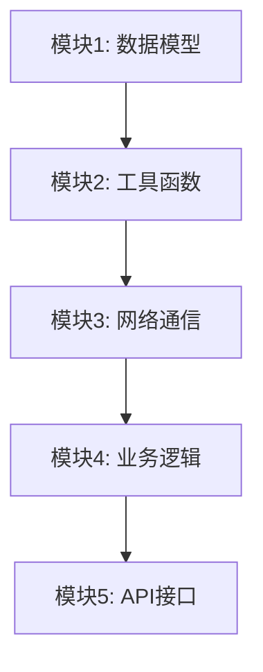

# 模块拆解模板

复刻前必须先完成模块拆解。将目标软件拆分为独立、可测试、可排序的模块清单。

---

## 模块拆解表

### 项目基本信息

| 项 | 值 |
|----|-----|
| 目标软件 | `<名称 + 版本>` |
| 复刻目标技术栈 | `<如 Vue3 + Express + MySQL>` |
| 分析报告 | `<报告文件路径或引用>` |
| 拆解日期 | `<YYYY-MM-DD>` |

### 模块清单

#### P0 - 核心路径（必须复刻）

| # | 模块名 | 职责 | 输入 | 输出 | 依赖模块 | 逆向证据 | 预估复杂度 |
|---|--------|------|------|------|---------|---------|-----------|
| 1 | `<模块名>` | `<一句话>` | `<参数>` | `<返回值>` | `<依赖的模块#>` | `<发现#N / 函数地址>` | `<低/中/高>` |
| 2 | | | | | | | |

#### P1 - 重要功能（建议复刻）

| # | 模块名 | 职责 | 输入 | 输出 | 依赖模块 | 逆向证据 | 预估复杂度 |
|---|--------|------|------|------|---------|---------|-----------|
| 1 | | | | | | | |

#### P2 - 边缘功能（可选复刻）

| # | 模块名 | 职责 | 备注 |
|---|--------|------|------|
| 1 | | | |

---

## 模块依赖图

用文本或 Mermaid 表示模块间依赖关系：



无依赖的底层模块先实现，被依赖多的模块优先保证质量。

---

## 每个模块的详细规格（P0 模块必填）

### 模块：`<模块名>`

**职责描述**：
<这个模块做什么，不做什么>

**接口定义**：
```
<函数/方法签名，包含参数类型和返回值类型>
```

**核心逻辑**：
<基于逆向分析的算法步骤描述，1-3 句话>

**逆向证据**：
- 原始函数地址：`<0x...>`
- 分析报告发现：`<#N>`
- 关键伪代码片段：
```
<REA 返回的伪代码摘要>
```

**边界条件**：
- [ ] 空输入处理
- [ ] 极值处理
- [ ] 异常/错误路径

**测试用例**：
| 输入 | 预期输出 | 来源 |
|------|---------|------|
| `<值>` | `<值>` | `<逆向观察/推断>` |

**技术栈映射说明**：
<原始实现用了什么，映射到目标技术栈用什么替代，为什么>

---

## 拆解质量检查

- [ ] 每个 P0 模块都有明确的输入输出
- [ ] 模块间依赖无循环
- [ ] 每个模块都有对应的逆向证据
- [ ] P0 模块构成最小可运行版本
- [ ] 没有遗漏原始软件的核心功能
- [ ] 复杂度评估合理（高复杂度模块考虑进一步拆分）
- [ ] 用户已确认模块范围和优先级
